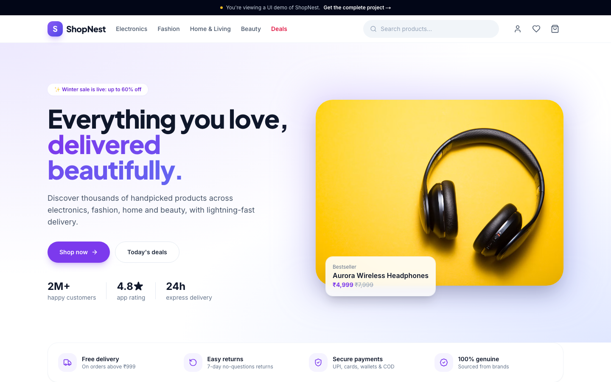
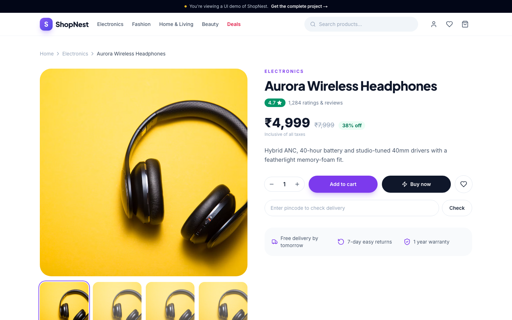
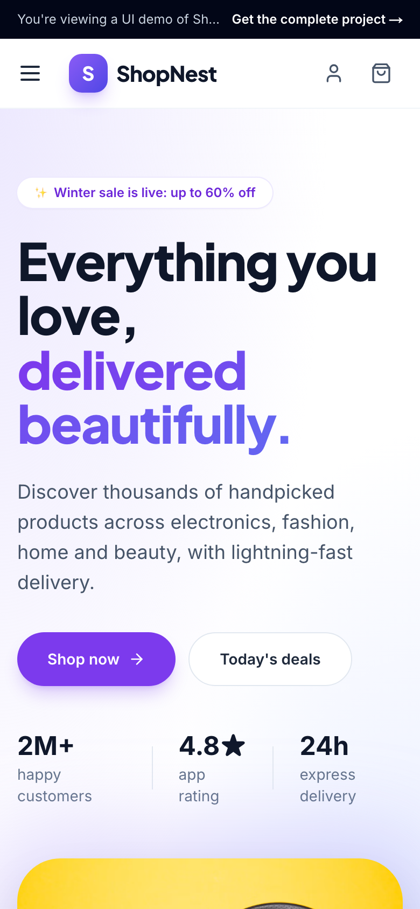

# E-commerce Website Development Company

Build a professional, scalable, and feature-rich e-commerce website with **Naya Prayog Technologies**.

We provide custom e-commerce website development services for businesses, startups, retailers, manufacturers, wholesalers, and established brands looking to sell products online.

From designing a professional online store to developing custom shopping experiences, payment integrations, inventory management, and order processing systems, we build e-commerce solutions around your business requirements.

Whether you are starting a new online business or transforming an existing retail operation, our team can help you develop a digital commerce platform designed for long-term growth.

**Website:** https://nayaprayog.com/

---

<!-- screenshots -->
## Screenshots

**Home**

**Product Page**

<table>
  <tr>
    <td align="center" width="260"><b>Mobile View</b>  </td>
  </tr>
</table>

---

## Custom E-commerce Website Development Services

An e-commerce website allows businesses to showcase products, attract customers, accept online orders, process payments, and manage their sales through a digital platform.

At Naya Prayog Technologies, we develop customized e-commerce websites with business-specific functionality, responsive user interfaces, and scalable backend systems.

Our e-commerce development services include:

- Custom e-commerce website development
- Online shopping website development
- B2B e-commerce platform development
- B2C e-commerce website development
- D2C e-commerce website development
- Single-vendor online store development
- Multi-vendor marketplace development
- Wholesale e-commerce solutions
- Retail e-commerce development
- Custom shopping cart development
- E-commerce admin dashboard development
- E-commerce API and third-party integrations

## Who Needs an E-commerce Website?

We develop online commerce solutions for:

- Retail shops and businesses
- Fashion and clothing brands
- Grocery and supermarket businesses
- Electronics and appliance retailers
- Furniture and home decor stores
- Beauty and cosmetics brands
- Healthcare and pharmacy businesses
- Manufacturers and distributors
- Wholesale suppliers
- Consumer product brands
- E-commerce startups
- Established businesses expanding online

## Key Features & Capabilities

The following features can be developed according to your business requirements and agreed project scope.

### 1. Professional E-commerce Storefront

Create a modern shopping experience for your customers.

- Responsive homepage design
- Professional product layouts
- Product categories and subcategories
- Product search and filtering
- Product details and image galleries
- Product pricing and availability
- Featured and trending products
- Related product recommendations
- Customer registration and login
- Wishlist functionality
- Shopping cart
- Customer account dashboard

### 2. Product & Catalog Management

Manage products and categories through a centralized system.

- Add, edit, and manage products
- Product categories and subcategories
- Product images and descriptions
- Product variants and attributes
- Size, color, and other product options
- SKU and product identification
- Regular and discounted pricing
- Product stock management
- Featured products and collections
- Bulk product management, where required

### 3. Shopping Cart & Checkout

Provide a convenient checkout experience.

- Add products to cart
- Update product quantities
- Remove products from cart
- Shipping address management
- Order summary
- Coupon and discount application
- Shipping charge calculation
- Guest checkout, where required
- Order confirmation
- Checkout validation

### 4. Payment Gateway Integration

Enable customers to pay through suitable payment methods.

- UPI payments
- Debit and credit cards
- Net banking
- Supported payment gateways
- Cash on Delivery, where applicable
- Payment status tracking
- Transaction records
- Refund workflow integration, where supported

### 5. Order & Delivery Management

Manage orders from checkout to delivery.

- Order placement and confirmation
- Order processing
- Order status management
- Packing and dispatch
- Shipping provider integration
- Shipment tracking
- Delivery notifications
- Order cancellation
- Return and exchange workflows
- Refund management

### 6. Inventory & Stock Management

Maintain visibility into product availability and stock movement.

- Product stock management
- Automatic stock updates after orders
- Low-stock notifications
- Stock adjustment records
- Purchase management
- Supplier management
- Product availability tracking
- Multi-location inventory, if required

### 7. E-commerce Admin Dashboard

Manage your complete online business through a centralized administration panel.

Potential dashboard capabilities include:

- Sales and revenue overview
- Product management
- Category management
- Inventory management
- Customer management
- Order management
- Payment and transaction records
- Coupon and discount management
- Shipping configuration
- Tax and invoice settings
- Website banner and content management
- Sales reports and analytics
- Admin user management
- Role-based access permissions

### 8. Customer Management & Marketing

Build customer relationships and improve repeat purchases.

- Customer profiles
- Customer order history
- Customer reviews and ratings
- Promotional coupons
- Discount campaigns
- Featured product collections
- Email notifications
- SMS and WhatsApp integration
- Push notifications
- Search engine optimization
- Social media integration
- Abandoned cart workflows, where required

### 9. E-commerce Integrations

Connect your online store with external services and business systems.

- Payment gateway APIs
- Shipping and logistics APIs
- Email and SMS services
- WhatsApp integrations
- Accounting and billing software
- Inventory and ERP systems
- CRM integrations
- Analytics and reporting tools
- External product and business APIs

Integration availability depends on the selected provider and its API capabilities.

## Types of E-commerce Websites We Develop

| E-commerce Solution | Business Application |
|---|---|
| B2C E-commerce Website | Sell products directly to individual customers |
| B2B E-commerce Platform | Support business-to-business purchasing |
| D2C E-commerce Website | Allow brands to sell directly to consumers |
| Single-Vendor E-commerce | One business manages its online store |
| Multi-Vendor Marketplace | Multiple sellers operate through one platform |
| Wholesale E-commerce | Manage bulk orders and wholesale pricing |
| Retail E-commerce | Take traditional retail businesses online |
| Custom E-commerce Website | Build a solution for specialized business workflows |

## Why Choose Naya Prayog Technologies?

Naya Prayog Technologies is a software development and business automation company providing digital solutions for businesses in India and internationally.

We focus on delivering e-commerce solutions that align with your business operations.

- Custom website development
- Professional UI/UX design
- Responsive and mobile-friendly interfaces
- Scalable backend architecture
- Custom admin dashboards
- Secure payment gateway integrations
- Inventory and order workflow automation
- Third-party API integrations
- Website deployment and configuration
- Ongoing improvements and technical support

We prioritize practical business requirements, maintainability, and future scalability.

## Technology & Development

We select the technology stack according to the requirements and expected scale of the project.

- Frontend: React.js, Next.js, HTML, CSS, JavaScript
- Backend: Node.js, Express.js, Python, Django
- Database: MySQL, PostgreSQL, MongoDB
- Mobile Applications: Flutter
- Integrations: Payment gateways, shipping APIs, email and notification services
- Deployment: Cloud hosting and VPS environments

The final architecture is selected according to performance, security, integrations, maintenance, and scalability requirements.

## Our E-commerce Development Process

1. **Requirement Analysis** – Understand your products, customers, business model, and operational requirements.
2. **UI/UX Design** – Design an intuitive storefront and shopping experience.
3. **Architecture Planning** – Plan the frontend, backend, database, and integrations.
4. **Development** – Build the e-commerce website, administration system, and required modules.
5. **Integration** – Configure payment gateways, shipping services, and third-party APIs.
6. **Testing** – Test product browsing, checkout, payments, orders, and administrative workflows.
7. **Deployment** – Deploy the website to your selected hosting environment.
8. **Ongoing Improvements** – Expand functionality as your business grows.

## Frequently Asked Questions

### What is e-commerce website development?

E-commerce website development involves designing and building online platforms where businesses can display products, accept orders, process payments, and manage digital sales operations.

### How much does it cost to develop an e-commerce website?

The cost depends on website complexity, product catalog size, design requirements, integrations, and custom functionality. Contact our team for a project-specific estimate.

### Can you develop a completely custom e-commerce website?

Yes. We can develop a custom e-commerce website based on your business model, preferred design, workflows, and technical requirements.

### Can I manage products and orders myself?

Yes. An administration dashboard can be developed to manage products, categories, customers, inventory, and orders.

### Can you integrate online payment gateways?

Yes. We can integrate suitable payment providers based on your business location, provider availability, and project requirements.

### Can you develop B2B and B2C e-commerce websites?

Yes. We can build both business-to-business and business-to-consumer platforms with appropriate pricing, ordering, and customer workflows.

### Can you develop Android and iOS shopping applications?

Yes. Mobile applications can be developed alongside your e-commerce website or introduced as a later development phase.

### Can you redesign my existing e-commerce website?

Yes. We can help modernize existing online stores through UI/UX improvements, performance optimization, custom functionality, and backend enhancements.

## Build Your E-commerce Website

Planning to launch an online store, create a digital commerce platform, or modernize your existing e-commerce business?

Let's discuss your requirements and develop an e-commerce solution aligned with your business goals.

**Naya Prayog Technologies**

- Website: https://nayaprayog.com/
- Email: [support@nayaprayog.com](mailto:support@nayaprayog.com)
- Phone / WhatsApp: +91 7991327022
- WhatsApp: https://wa.me/917991327022
- Portfolio: https://github.helloharendra.io

**Contact us to discuss your custom e-commerce website development project.**

---

## Repository Information

This repository serves as a service and project showcase for e-commerce website development by Naya Prayog Technologies.

It does not grant permission to redistribute, resell, or commercially reuse proprietary company materials or software. Project-specific source code, deliverables, and licensing terms are agreed separately.
